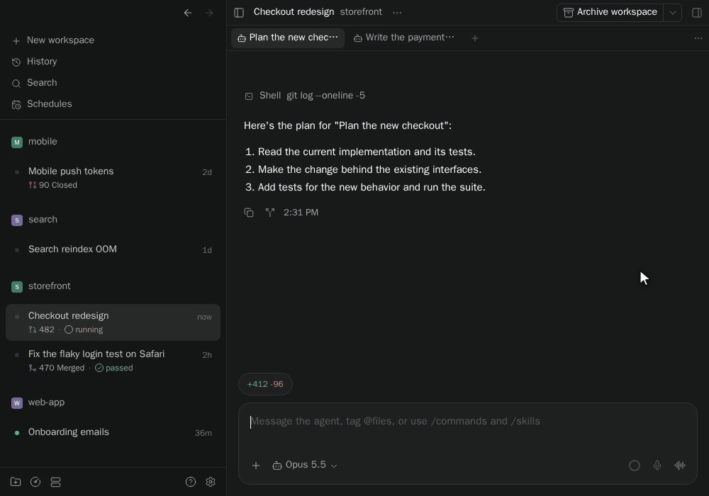
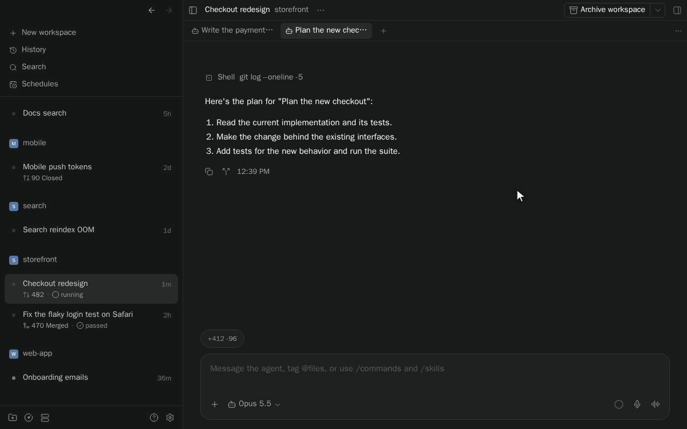

# paseo-switcher

[](https://www.npmjs.com/package/paseo-switcher)
[](https://www.npmjs.com/package/paseo-switcher)
[](https://paseo.sh)
[](LICENSE)

Arc-style Ctrl+Tab for Paseo workspaces, plus back/forward navigation through workspaces, sessions, tabs, plugin pages and Settings. Hold Ctrl and tap Tab to step through your most recently used workspaces, release Ctrl to switch. A quick Ctrl+Tab flips straight back to the previous workspace without drawing anything. Start typing while it is open to find any workspace by name, project, branch or pull request number.



Each row shows the full workspace name, project, branch, pull request with its checks and review, diff stat, unpushed commits, and what the agent is doing and for how long:

<picture>
  <source media="(prefers-color-scheme: light)" srcset="docs/media/switcher-list-light.png">
  
</picture>

Typing filters every workspace, not only the recent ones, and marks what matched:


Or choose the **Thumbnails** layout for a row of previews of how you left each workspace:


Recorded from the real plugin against a test daemon with sample workspaces; pull request details are sample data.

## Install

Install from npm using the latest Paseo release:

```sh
paseo plugin install paseo-switcher
```

## Use

| Keys | Action |
| --- | --- |
| Hold Ctrl, tap Tab | Open the switcher and move forward |
| Ctrl+Shift+Tab | Move back |
| Release Ctrl | Switch to the selected workspace |
| Quick Ctrl+Tab | Go straight back to the previous workspace |
| Arrows, Enter, 1–9 | Move, switch, or jump to a row |
| Type | Filter all workspaces; the switcher then stays open until Enter or a click |
| Esc | Clear the filter, then cancel |

While the switcher is open it takes every key, so typing never triggers a Paseo shortcut. Number keys jump to a row until you type a filter; after that they search pull request numbers too. Hovering a row selects it and clicking switches to it.

The Command Center has **Switch workspace (Ctrl+Tab)** for browser tabs, where the browser keeps Ctrl+Tab for itself, and for the web UI on a phone, where a tap switches.

The switcher owns Ctrl+Tab and Ctrl+Shift+Tab. A Paseo shortcut bound to either one, such as Next tab, does not fire while the plugin is installed.

**Settings → Plugins → Workspace Switcher** sets the **Layout**, **List** (default) or **Thumbnails**, and how many recent workspaces appear, from 2 to 9 (default 5). Settings and the visit order are saved per device.

Status follows Paseo's sidebar: a turning ring while an agent runs, amber when it needs input, red when it failed, and green when it finished and you have not looked yet.

## Back and forward

The arrows at the top of the sidebar retrace the places you visited, including the selected session or tab inside a workspace. Open plugin settings from a session, press Back to return to that session, then Forward to revisit the settings page. Closed tabs are skipped; opening something new after going Back clears the forward branch.



History stays in memory for the current window and starts fresh on reload. It is separate from Ctrl+Tab's recent-workspace order.

Mouse side buttons and the Command Center's **Go back** / **Go forward** commands use the same history. The default keyboard shortcuts are **Ctrl+- / Ctrl+Shift+-** on macOS and **Alt+Left / Alt+Right** elsewhere. **Settings → Plugins → Workspace Switcher → Navigation history** changes the shortcut pair (including **Cmd+[ / Cmd+]** or **None**) and hides or shows the arrows. Turn **Back and forward** off to disable the feature entirely: no arrows, shortcuts, mouse side-button handling or Go back / Go forward commands, and no history is recorded. Those keys and buttons then reach Paseo unchanged.

For a Logitech mouse on macOS, if the built-in Back/Forward assignments do nothing, create an app-specific **Paseo** profile in Logi Options+. Assign the side buttons to **Keyboard shortcut → Ctrl+-** and **Ctrl+Shift+-**, and select that same shortcut pair in the plugin. This uses Control, not Command. The plugin also accepts raw mouse buttons and BrowserBack/BrowserForward key events; native macOS commands that never reach the app need the shortcut mapping.

The plugin's navigation code executes inside your local Paseo app even when you install it on a remote host. Back/forward does not make a plugin RPC to that host. Opening uncached workspace content may still require Paseo to load it from the host.

The arrows stay mounted independently of Paseo's routed sidebar and keep their position while a workspace loads. Plugin availability still follows its host installation: replacing the host connection, reloading or disabling the plugin can reinstall or remove its client UI.

## How it stays fast

A quick tap does no drawing at all, only a click on the previous workspace. The list draws in about 2 ms and takes no thumbnails, and filtering redraws it in a few milliseconds per key. Navigation history observes route and tab changes without watching streamed chat content. Thumbnails are not live copies of the app: in that layout, while you stay in a workspace, the plugin rasterizes a small image of it when the browser is idle, and never during the two seconds after a switch. The strip itself is about 40 elements and draws in a few milliseconds. The end-to-end suite checks these budgets, along with the claim that normal sidebar switching is no slower with the plugin on. See [TESTING.md](TESTING.md).

## Limits

- The plugin reads Paseo's page structure, which is not a public plugin API, so it is pinned to Paseo 0.15 and may need an update when Paseo changes.
- It runs in the desktop app and the web UI, and does nothing on iOS and Android.
- In the Thumbnails layout, thumbnails are kept in memory only. A workspace you have not opened since the app started shows "No preview yet" instead.
- The switcher lists the workspaces of the host you are on. Recent workspaces from another host keep their sidebar name but show no details.
- Terminals, embedded previews and images loaded from the web appear blank in thumbnails.

## Development

```sh
npm ci
npm run verify                  # typecheck and unit tests
paseo plugin install .
npm run e2e -- --reload         # behavior and performance against a throwaway daemon (see TESTING.md)
npm run media                   # README media, against a daemon with sample workspaces
```

The end-to-end suite and media script drive Paseo's web UI in headless Chromium and log in with the daemon's local credential, so they need a running daemon but no password. Set `E2E_ORIGIN` and `PASEO_HOME` to run them against an isolated test daemon instead of your own. [TESTING.md](TESTING.md) explains every check.

## License

[MIT](LICENSE) © 2026 Tom Gringauz.

## Other plugins

- [Defer](https://github.com/tomgrin10/paseo-defer) — Schedule messages for later delivery.
- [Follow-up](https://github.com/tomgrin10/paseo-follow-up) — Track workspace PRs, remaining tasks and completion.
- [Send to Paseo](https://github.com/tomgrin10/send-to-paseo) — Send GitHub and Graphite PRs to Paseo from Chrome.
- [Session Guard](https://github.com/tomgrin10/paseo-session-guard) — Pause at session limits and continue after reset.
- [Smart Session](https://github.com/tomgrin10/paseo-smart-session) — Context compaction and usage insights.
- [Transcript Search](https://github.com/tomgrin10/paseo-transcript-search) — Search conversations across connected hosts.
- [Transfer](https://github.com/tomgrin10/paseo-transfer) — Copy or move workspaces between hosts.
- [Vitals](https://github.com/tomgrin10/paseo-vitals) — Host, process, agent and Docker monitoring.
